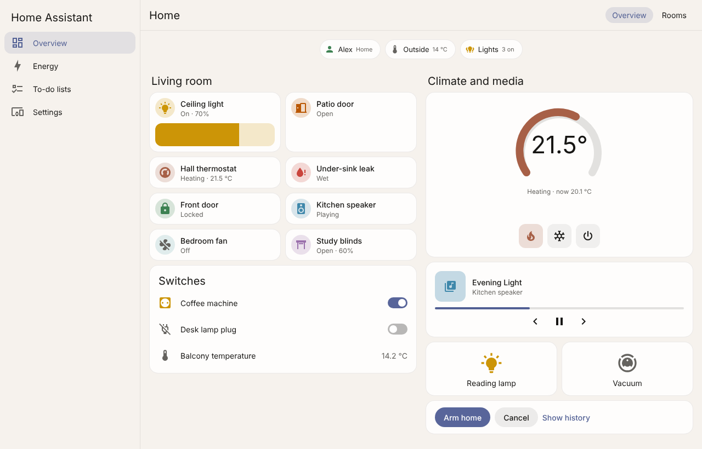
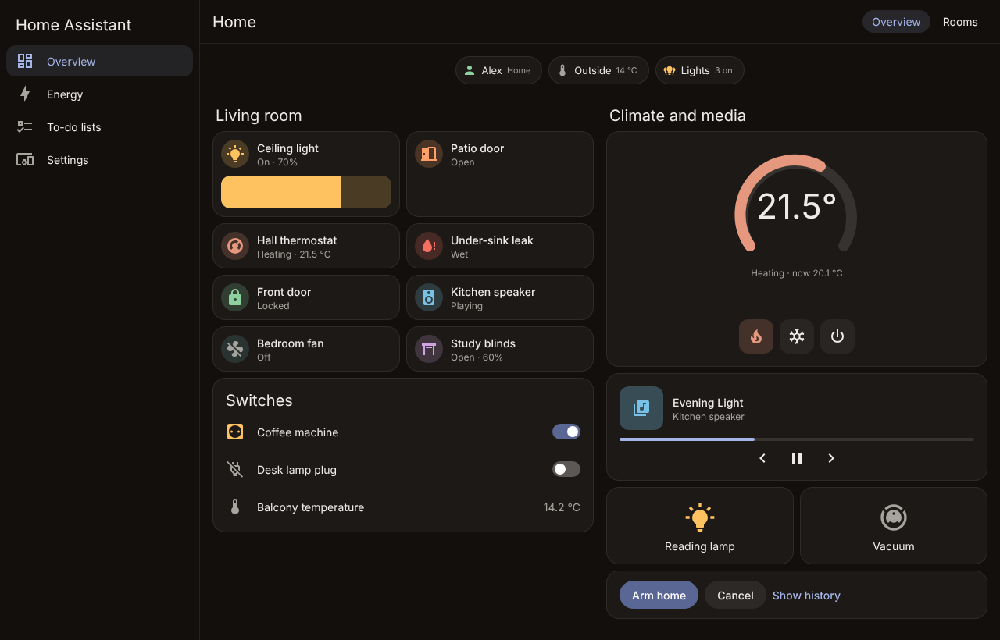
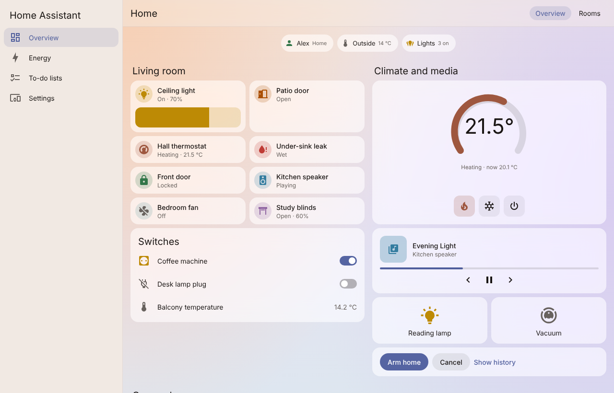
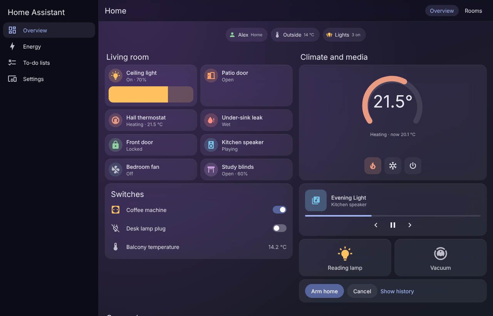
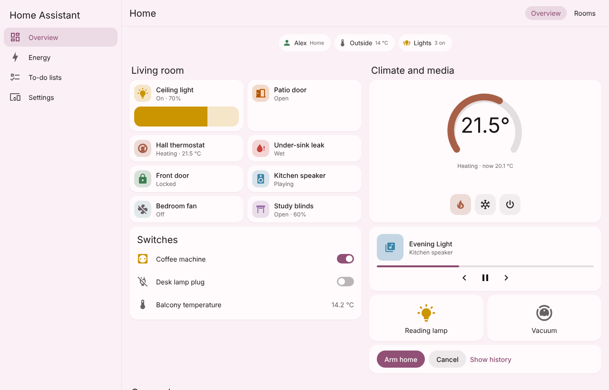
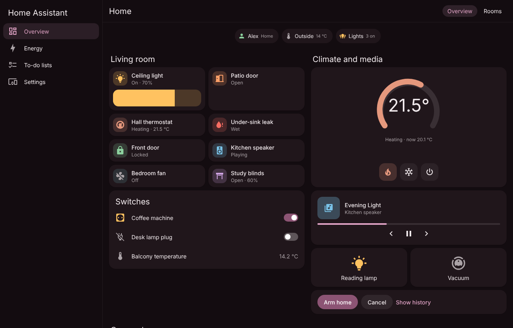

# Pulse Theme

[](https://hacs.xyz/docs/faq/custom_repositories)

A calm theme family for Home Assistant. Neutral surfaces, one accent, and colour only where it means something: a light that's on, a door that's open, a leak. Three variations share one palette of state colours, so you can switch between them without relearning what anything means. All three come in light and dark modes and meet WCAG AA contrast.

| | Light | Dark |
| :- | :- | :- |
| **Pulse**: matte, warm stone and linen greys, hairline edges, dusk-blue accent |  |  |
| **Pulse Glass**: frosted cards over a soft dusk-to-ember gradient, inspired by visionOS |  |  |
| **Pulse Tonal**: surfaces with a hint of warm mauve, rounded-square tile icons, inspired by Material You |  |  |

## Features

- **Built-in cards look calm too.** Pulse sets Home Assistant's own variables, so tile, area, entities, thermostat, media cards, dialogs, the sidebar and settings all change. You don't need any custom cards.
- **Colour that means something.** Muted green for "all good" (locked, home, armed), orange for "needs a look" (a door or window open, something running low), warm red for problems (leak, unlocked, alarm), gold for lights. Open doors and windows no longer share the "light on" colour.
- **Readable in both modes.** Every text, icon and state colour is checked against WCAG 2.1 AA in light and dark (`npm run contrast`). One deliberate exception is listed below.
- **Your device's own font.** SF on Apple devices, Segoe UI on Windows, Roboto on Android. Nothing to download, and it works offline.
- **The newer HA design tokens too.** Buttons, switches and checkboxes in recent frontends follow the accent instead of staying HA blue.
- **Design tokens for card authors.** Every colour, radius and rhythm is also exposed as a `--pulse-*` variable (see [For card authors](#for-card-authors)).

## Installation

### HACS (custom repository)

1. HACS → ⋮ → **Custom repositories** → add `https://github.com/zacharatos/pulse-theme`, category **Theme**.
2. Install **Pulse Theme**.
3. Make sure your `configuration.yaml` loads themes (HACS puts them in `config/themes/`):
   ```yaml
   frontend:
     themes: !include_dir_merge_named themes
   ```
4. Restart Home Assistant, or call `frontend.reload_themes`.
5. Open your **profile** and pick **Pulse**, **Pulse Glass** or **Pulse Tonal** under *Theme*. Leave *Dark mode* on *Auto* to follow your device, or pick light or dark.

### Manual

Copy `themes/pulse.yaml` into `config/themes/`, then follow steps 3–5 above.

You can also give a single dashboard view its own theme: edit the view and pick a theme under *Theme*.

## The three variations

| | Pulse | Pulse Glass | Pulse Tonal |
| :- | :- | :- | :- |
| Surfaces | Warm stone greys, solid | Frosted, translucent over a gradient | Warm, with a hint of the accent |
| Accent | Dusk blue | Dusk blue | Warm mauve |
| Card edges | 1px hairline, no shadow | No border, 1px inner highlight | No border, very soft shadow |
| Tile icons | Circles | Circles | Rounded squares (HA 2026+) |
| Cost | None | Blur (see below) | None |

**About Pulse Glass and older tablets.** Frosted glass is the one heavy thing a theme can do: the browser re-blurs everything behind every card while you scroll. Phones and PCs from the last few years handle it easily. An old wall tablet may stutter, so use Pulse or Pulse Tonal there. Each device can have its own theme in its profile.

## Accessibility

Contrast is measured, not eyeballed: 80–81 pairs per variation and mode, covering text on cards, page, chips, dialogs, header and sidebar; text on buttons; and every state colour as an icon on its tile tint and on a chip, plus as text where it's used as text. For Pulse Glass, every pair is measured against the worst case: the frosted card over each colour of the gradient.

**One deliberate exception.** In light mode, lights use a bright gold that reaches about 2.6:1 on a card and 2.2:1 on its own tile tint, below the 3:1 minimum for icons. Every yellow that reaches 3:1 on a light background looks mustard or brown. A light's state is always also written as text ("On · 70%"), so colour is never the only signal. In dark mode, lights pass normally.

## What Pulse doesn't change

A theme can only set variables that Home Assistant exposes. It can't change:

- A light's real colour on tiles and in more-info. That's intended: it's meaningful colour.
- Icons, layout and density of the built-in cards, and HA's own animations.
- The coloured icons in the Settings menu, brand images and logos (HA hard-codes them).
- The background of a view that has its own background set in the dashboard editor (your choice wins over Pulse Glass's gradient).
- Motion and other "detected" sensors. They use HA's generic *active* colour, which is the lights' gold. To change that, override `state-binary_sensor-motion-on-color` (or any other `state-<domain>-<device_class>-<state>-color`) in your own copy of the theme.
- **On Home Assistant 2025.x:** feature bars keep a fixed 12px radius (same value anyway), tile icons stay circles in Pulse Tonal, and buttons and switches follow `primary-color` through the older component styles.

## For card authors

Pulse exposes its decisions as `--pulse-*` CSS variables. Read them first, then fall back to Home Assistant's variable, then to your own default, so your card looks right with or without the theme:

```css
:host {
  --my-accent: var(--pulse-accent, var(--primary-color));
  --my-chip-bg: var(--pulse-surface-neutral, color-mix(in srgb, var(--primary-text-color) 6%, transparent));
  --my-bad: var(--pulse-bad, var(--error-color, #db4437));
}
```

| Token | Meaning |
| :- | :- |
| `--pulse-accent`, `--pulse-on-accent` | The one accent, and text on an accent fill |
| `--pulse-surface-neutral`, `-hover`, `-strong` | Fills for chips, rows and controls (a share of the text colour) |
| `--pulse-ok` | All good: home, locked, armed, in stock |
| `--pulse-info` | Information, cooling |
| `--pulse-warn` | Needs a look: open, low, arming |
| `--pulse-bad` | A problem: leak, unlocked, alarm, out of stock |
| `--pulse-active` | Something is on (lights, switches) |
| `--pulse-cold`, `--pulse-warm` | Temperature below or above range |
| `--pulse-dry`, `--pulse-humid` | Humidity below or above range |
| `--pulse-glow-day`, `--pulse-glow-night`, `--pulse-glow-alpha` | Sun and moon glows, and how strong a meaningful glow may be |
| `--pulse-radius`, `--pulse-control-radius`, `--pulse-chip-height` | 16px cards, 12px controls (14px in Tonal), 30px pill chips |
| `--pulse-gap`, `--pulse-pad`, `--pulse-row-height` | 12px, 12px, 56px |
| `--pulse-motion-fast`, `-normal`, `-slow`, `--pulse-ease` | 150 / 250 / 350 ms and a calm easing curve |

Home Assistant also creates `--rgb-pulse-<name>` (as `r, g, b`) for every colour token, for use in `rgba()`.

The motion tokens are plain values. They don't switch off for reduced motion, because a theme can't do that without overriding HA's own reduced-motion handling. Wrap your transitions in `@media (prefers-reduced-motion: reduce)` yourself.

## Development

There is nothing to install: the scripts are plain Node (22+) with no dependencies.

```bash
npm run build      # regenerate themes/pulse.yaml from scripts/palette.mjs
npm run contrast   # check every pair against WCAG AA (exit 1 on failure)
npm run check      # both
```

- `themes/pulse.yaml` is **generated**. Change colours in `scripts/palette.mjs`: each colour is a hue and chroma, and the solver finds the lightness that meets its contrast target. CI fails if the committed YAML is stale or any pair drops below AA.
- `test/preview.html` applies the theme the way Home Assistant does and shows native-style cards next to the Pulse cards. Serve the folder that contains this repo and its sibling card repos, then open `pulse-theme/test/preview.html` (`?theme=pulse|glass|tonal|none`, `?dark=1`, `?lang=el`, `?width=380`). The screenshots above come from it.
- `test/ha/` runs a throwaway Home Assistant with the demo integration and the Pulse cards, and takes screenshots of it (see `test/ha/README.md`).

## License

MIT
